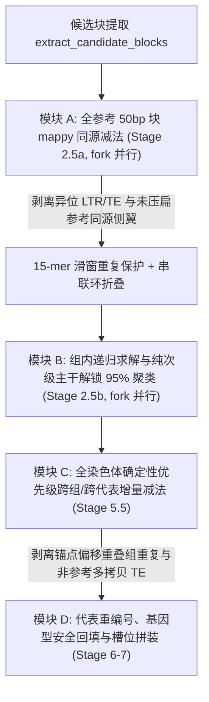

# PanFlat 同源冗余序列算法级消除方案（`DEDUP_PLAN.md`）

> **目标**：针对梨 `Chr06A`（参考 `25.23 Mb` → 当前 `133.72 Mb`，`--qc` 实测 `≥95%` 同源冗余达 **`60.88%` / `62.47 Mb`**、`≥90%` 同源冗余达 **`82.95%` / `85.12 Mb`**）暴露出的膨胀问题，在不破坏三大全局不变量（I / II / III）、GFF3 蛋白精确还原与 **T22** 多核逐字节确定性的前提下，从算法层面彻底剥离参考已有同源序列与跨组重复挂载序列，将线性泛基因组压回 **`~36–43 Mb`** 的非冗余真实 PAV 规模。
>
> **状态**：已完成 `Chr06A` 实测冗余账单拆解与全流程白盒架构设计（尚未修改业务源码与 `panflat_v1_final_revised.md`）。

---

## 1. 实测膨胀账单与四层消冗架构

### 1.1 `Chr06A` 实测数据复盘
- `ref_len` = `25,227,752 bp`（`25.23 Mb`）
- `pan_len` = `133,718,575 bp`（`133.72 Mb`），其中 `N` 间隔符 `4.79 Mb`、非 `N` 插入序列 `103.70 Mb`（`≥150 bp` 片段 `102.61 Mb`）
- `--qc` 同源冗余统计：
  - `qc_redundancy_0.95_bp` = `62,468,944 bp`（**`60.88%`**）
  - `qc_redundancy_0.90_bp` = `85,119,848 bp`（**`82.95%`**）
- 扣除 `≥90%` 同源冗余后，真正 `<90%` 的非冗余新增序列为 `102.61 - 85.12 = 17.49 Mb`（参考 + 真新序列 ≈ **`42.72 Mb`**，与 PSVCP 的 `35.68 Mb` 处于同一量级）。

### 1.2 四层消冗流水线设计



| 冗余根源 | `Chr06A` 典型表现 | 对应改造模块 |
|---|---|---|
| **1. 普通区仅按图节点 ID 判新颖，无参考序列减法** | 异位插入的多拷贝 Gypsy/Copia 转座子（5–15 kb）及 PGGB 未压扁同源区整段进入 `pan.fa` | **模块 A**：在 Stage 2.5a `fork` 进程池最前端对整条参考染色体做 50 bp 网格 `mappy` 同源减法 |
| **2. 无子分支的多成员组件被锁死为 `is_synthetic=True`** | 组内 2 个单倍型仅差 1 个 SNP 即进入递归并标为 `is_synthetic`，跳过与 `rep0` 及其他代表的相似聚类 | **模块 B**：当 `_solve_multi_member_component` 无活跃子分支（输出纯 `b_sec` 真实序列）时恢复 `is_synthetic=False` |
| **3. 跨锚点组 `G(a1,b1)` 与 `G(a2,b2)` 完全隔离** | `8.58–9.44 Mb` 近着丝粒区因断点差几步拆出十几个 `n=1~2` 重叠组，把同一段 400–800 kb 序列重复塞入十几遍；非参考新 TE 跨位点重复挂载 | **模块 C**：在 Stage 5.5 按确定性优先级对全染色体所有代表执行增量 `mappy` 块级同源减法 |
| **4. 局部差异导致整条大块“全有或全无”保留** | 30 kb 候选中 27 kb 同源 + 3 kb 真新序列时，因 `check_similarity_merge` 失败而保留整条 30 kb | **模块 A + 模块 C**：均采用 50 bp 块级掩码 + `protected_ins` 内部新插入保护，自动切掉 27 kb 同源侧翼、仅保留 3 kb 真新岛 |

---

## 2. CLI 参数与配置扩展（向后兼容契约）

**目标文件**：
- `panflat/models.py`（`BuildConfig`，L398–435）
- `panflat/cli.py`（`_build_parser`、`main`，L60–152）
- `panflat/gfa_io.py`（`validate_build_config`）

新增两个构建参数：
1. `--dedup-mode {off,ref,pan}`（初始默认 `off` 以保证现有 543 个严格 v1 回归测试零改动通过；真实基因组构建推荐 `--dedup-mode pan`，也可按需调整默认值）：
   - `off`：严格保持现有 v1 仅按图节点 ID 提取的行为；
   - `ref`：启用 **模块 A + 模块 B**（消除相对参考染色体的同源冗余及组内伪合成冗余，保留不同位点间的同源新插入）；
   - `pan`：启用 **模块 A + 模块 B + 模块 C**（消除相对参考 **以及** 跨组/跨位点代表之间的同源冗余，直接对标 PSVCP 紧凑度）。
2. `--dedup-id <float>`（默认 `0.90`，合法范围 `[0.80, 0.99]`）：
   - 控制模块 A 与模块 C 中 50 bp 查询块的同源屏蔽身份度阈值 `M / (M + X + I + D) >= dedup_id`（设 `0.95` 对齐 `--qc` 0.95 口径；默认 `0.90` 对齐 `--qc` 0.90 口径，直接覆盖 `Chr06A` 上 `82.95%` 的同源冗余）。

> [!IMPORTANT]
> `panflat_v1_final_revised.md` 保持 0 字节改动；着丝粒 `extract-islands` 内部的 Step B 仍固定使用规范规定的 `0.85` 阈值，不受 `--dedup-id` 影响。

---

## 3. 分模块详细代码修改方案

### 模块 A：普通区域全染色体参考同源减法（Stage 2.5a）

**目标文件**：
- `panflat/repeat_guard.py`（`_evaluate_mappy_hits_on_blocks`、`subtract_reference_intervals_mappy`，L662–833）
- `panflat/linearizer.py`（`screen_and_fold_candidate` L885–1186、`_Stage5ForkContext` & `_screen_and_solve_one_pair` L3443–3578、`run_chromosome_pipeline` L3971–3988）

#### A.1 泛化 `subtract_reference_intervals_mappy`（`panflat/repeat_guard.py`）
1. 在 `_evaluate_mappy_hits_on_blocks` 与 `subtract_reference_intervals_mappy` 中增加可选参数：
   - `min_identity: float = REF_SUB_MIN_IDENTITY`（将原硬编码 `m_cnt * 100 >= 85 * denom` 泛化为 `m_cnt + 1e-12 >= min_identity * denom`）；
   - `short_aligner: Any | None = None`：当查询长度（或未对齐子区间长度）`<= 500 bp` 且传入了短种子索引（`k=13, w=5, min_cnt=2, min_chain_score=20, best_n=50`，与 `verify_qc.py::run_qc` 完全同口径）时，合并主索引与短索引命中，防止 `50–250 bp` 短同源块因 `asm20`（`k=19, w=10`）漏检；
   - 保持双链（`+`/`-`）屏蔽与 **`protected_ins` 内部新插入保护机制**不变：凡单条命中内部出现长度 `>= min_sv_len` 的连续查询插入 `I`，禁止该条命中遮蔽这段新插入，并通过迭代重比对（L794–830）回收 `zdrop` 截断的同源侧翼。

#### A.2 父进程预建只读参考索引 + `fork` COW 零拷贝并发（`panflat/linearizer.py`）
1. 在 `run_chromosome_pipeline` 启动 Stage 5 进程池之前（当 `config.dedup_mode in ("ref", "pan")` 时）：
   - 主进程构建一次全参考染色体只读索引：
     - `ref_dedup_aligner = mappy.Aligner(seq=graph.ref_seq.upper(), preset="asm20", best_n=50)`
     - `ref_dedup_short_aligner = mappy.Aligner(seq=graph.ref_seq.upper(), k=13, w=5, min_cnt=2, min_chain_score=20, best_n=50)`
   - 放入 `_Stage5ForkContext`；Linux `fork` 下所有 worker 子进程通过 COW 零拷贝共享同一份 C 内存索引（25 Mb 参考仅占 ~80–120 MB、耗时 <0.8s）；每个 worker 局部复用一对 `mappy.ThreadBuffer()`；Stage 5 结束后立即释放这两个索引并 `gc.collect()`。
2. **在 `screen_and_fold_candidate` 最前端接入参考减法**：
   - 执行顺序：**Step 1 参考同源减法** → **Step 2 15-mer `repeat_mask_intervals`（仅针对 Step 1 保留的 `>= 500 bp` 残余）** → **Step 3 `fold_tandem_cycles`（针对 `>= min_sv_len` 残余）**。
   - 对 `raw_cand.seq` 调用 `subtract_reference_intervals_mappy`：
     - 若存在 `ref_masked_intervals`：用 `slice_candidate_by_intervals` 将原始 `(steps, provenance)` 精确切割为未屏蔽的连续子区间（自动维护半节点 `Step.subslice` 与原始 GFA 0-based `StepProvenance`）；
     - 累计被减掉的碱基数至 `guard_res.ref_masked_bp`；被切开保留下来的多个 `>= min_sv_len` 残余**严禁跨屏蔽区直接拼接**，各自作为独立候选传递，并标记 `partial_content = True`（及左前缀被切时 `left_anchor_contiguous = False`）；
     - 若整条候选被减完（无 `>= min_sv_len` 残余），将 `(raw_cand.hap_id, raw_cand.src_path)` 记入 `guard_res.contig_had_subtracted_homolog`，日志记 `final_reason = "REFERENCE_LIKE"`（依据规范 §3.8.5，已由参考解释的序列不写入 `unresolved.tsv` / `unresolved.fa`，避免磁盘膨胀）。
   - **性能收益**：在 `Chr06A` 这类数据上，70%+ 的近着丝粒巨型块与异位 LTR 在 Stage 5 worker 入口就被切掉，后续并查集递归、序列聚类与跨进程 IPC 回传体积同步下降一个数量级。

---

### 模块 B：解锁无子分支次级主干组件的相似聚类（Stage 2.5b）

**目标文件**：`panflat/linearizer.py`（`_solve_multi_member_component`，L1772–1795）

- **问题根因**：当前实现在 `if not active_child_solutions:` 分支（即组件内各成员之间只有 `< min_sv_len` 的微小 SNP/InDel 差异，最终输出 100% 等于单供体真实连续序列 `b_sec.seq`，未拼入任何子代表或 `'N'`）仍硬编码返回 `is_synthetic=True`，导致其在 `solve_parallel_group`（L2100–2220）Step 4 中无法与主干 `rep0` 或其他组件做相似聚类。
- **修改方案**：当 `config.dedup_mode in ("ref", "pan")` 且 `not active_child_solutions` 时，返回 `is_synthetic=False`，使其按真实序列正常参与 Step 4 的 4 判据相似聚类（含并入 `rep0`）。

---

### 模块 C：全染色体跨组/跨代表确定性优先级同源减法（Stage 5.5，`--dedup-mode pan`）

**目标文件**：`panflat/linearizer.py`（Stage 5 与 Stage 6 之间 L4130–4145，新增 `_deduplicate_representatives_across_chromosome` 与 `_subslice_piece`）

在 Stage 5 所有 `G(a, b)` 求解完毕后、Stage 6 生成 `SVEvent` 与 `InsertionSlotBlock` 之前，对全染色体所有存活的非主干代表执行确定性跨组消冗：

#### C.1 全局确定性优先级排序（100% 独立于样本输入顺序，严格满足 T22）
1. 若启用了 `--centromere-mode extract-islands`，先将 `cen_out.island_slot_blocks` 中的所有 `CEN_ISLAND` `Piece` 放入初始已接受序列池（第 0 优先级，保证普通区不会重复挂载着丝粒已提取的序列岛）。
2. 收集所有普通组 `pair = (rank_a, rank_b)` 的 `ClusterRepresentative`（Stage 5 worker 在 `config.dedup_mode == "pan"` 时保留轻量的 `len(rep.support_haps)`、`rep.token_str` 与 `rep.pieces`，待 Stage 5.5 完成后统一清空临时字段）。
3. 按以下全局优先级键排序所有代表：
   ```python
   priority_key = (
       -support_hap_count,          # 1. 高频群体共享代表优先成为泛基因组基准拷贝
       ref_e_open - ref_s_open,     # 2. 锚点跨度更紧凑的位点（纯插入 span=0）优先于近着丝粒宽跨度组
       -rep.length_bp_no_n,         # 3. 完整长序列优先于截断碎片
       rank_a,                      # 4. 染色体坐标升序确定性打破平局
       rank_b,
       rep.rep_idx,
       rep.token_str,
   )
   ```
   > [!TIP]
   > 第 2 优先级 `ref_e_open - ref_s_open` 专门针对 `Chr06A` Top 10 那类近着丝粒锚点漂移：如果某段新序列在某个单倍型有干净紧凑的局部锚点，而在另一单倍型落入跨度 400 kb 的 `1304894..1327984` 大跨越组，算法保证它优先挂载在干净位点，并把大跨越组里的冗余副本减掉。

#### C.2 分波次增量索引 + 多线程并发减法（兼顾精确贪心语义与多核性能）
为避免逐条重建 4 万次 `mappy` 索引，同时**严格保证只有真正被最终保留进 `pan.fa` 的序列才能屏蔽后续低优先级候选**（杜绝链式传递误删）：
1. **精确重复快筛**：维护已接受 piece 序列的正向与反向互补哈希集合 `accepted_exact_seqs`，O(1) 过滤 100% 相同的跨组代表。
2. **按已接受碱基预算分波（Wave Buffering，每波阈值 `B = 1.5 Mb`）**：
   - 每次从优先级队列顺序取出一批待检代表（累计待检碱基约 `2 Mb`）：
     1. 先用此前所有已封存波次的只读 `mappy` 索引列表（复用 `ThreadPoolExecutor` + `mappy.ThreadBuffer` 多线程无 GIL 并发）一次性批量屏蔽当前批次所有候选的各 `Piece`；
     2. 对批次内幸存的残余 `Piece`，按严格优先级顺序逐个与当前活跃小缓冲区（`< 1.5 Mb`）比对减法：凡幸存长度 `>= config.min_sv_len` 的新残余 `Piece`，立即追加进当前活跃缓冲；当活跃缓冲累计满 `1.5 Mb` 时封存为一个只读分块 `mappy` 索引（主索引 `asm20` + 短索引 `k=13, w=5`）。
   - **性能测算**：若最终非冗余新序列为 `15 Mb`，全流程仅构建 **~10 个 1.5 Mb 小索引**（建索引总耗时 `< 0.5s`），全部比对跑满 `config.threads` 多线程并发，单条染色体 Stage 5.5 耗时仅 **1–3 秒**，且与 `--threads 1` 结果 **100% 逐字节一致**。

#### C.3 `Piece` 级安全切片算子 `_subslice_piece`（严守全局不变量 II）
- **绝不跨 `'N'` 拼接比对**：每个代表内部的多个 `Piece` 独立比对减法，防止跨人工 spacer 产生伪命中。
- 当单个 `Piece` `p` 经减法得到未屏蔽区间列表 `unmasked_ivs` 时，过滤保留 `iv_e - iv_s >= config.min_sv_len` 的子区间 `[iv_s, iv_e)`：
  - 若 `p.src_strand == "+"`：`new_start = p.src_start + iv_s`，`new_end = p.src_start + iv_e`；
  - 若 `p.src_strand == "-"`：`new_start = p.src_end - iv_e`，`new_end = p.src_end - iv_s`；
  - **接头标注（`join_before`）**：
    - 第 1 个幸存子片：若 `iv_s == 0` 继承原 `p.join_before`；若 `iv_s > 0`（左前缀被同源减法切掉），若原 `p.join_before == "spacer"` 仍为 `"spacer"`，否则标为 `"synthetic"`（若同一代表的前置已保留 piece 被切掉尾部导致中间断开，则强制改为 `"spacer"` 插入 `'N' * spacer_n`，**严禁把被同源块隔开的两端无缝拼成人工嵌合序列**，严格遵循规范 §3.6.6 / §3.8.4-B“禁止跨屏蔽区拼接”）；
    - 同一 `Piece` 裂变出的第 2 个及后续幸存子片：`join_before` 统一设为 `"spacer"`（由 `assemble_pan_and_offsets` 自动插入单段 `'N' * spacer_n`）。

---

### 模块 D：代表重编号、基因型安全回填与校验统计（Stage 6–7 & `verify` / `merge`）

**目标文件**：
- `panflat/linearizer.py`（L4876–5235）
- `panflat/writers.py`
- `panflat/verify_qc.py`

1. **组内代表收缩与重映射**：
   - 若某代表 `rep` 被局部裁剪（仍保留 `>= 1` 个 `Piece`）：更新 `rep.pieces`、`rep.length_bp_no_n = sum(len(p.seq) for p in new_pieces)`，更新映射到该代表的 `cand_to_reconstructed_len`，并将对应等位标记 `partial_content = True`（在 `sv.tsv` 的 `alleles` 列自动输出 `,partial_content=1`）；
   - 若某代表 `rep` 被 100% 减空：将其从 `sol.non_backbone_reps` 中剔除，对剩余代表按原顺序紧凑重编 `new_rep_idx = 1 .. K'`，同步重映射 `sol.cand_to_rep_idx`（被剔除代表的候选映射为 `-1` 标记“已同源减除”）；
   - 若整组 `G(a, b)` 的 `sol.non_backbone_reps` 变为空元组 `()`：**该组不生成 `INS` 事件、不生成 `InsertionSlotBlock`、不写入任何 `'N'` spacer**（顺带消除数 Mb 多余 `'N'` 间隔符；同位点的 `DEL` / `CNV` / `INV` / `DUP_TRA` 仍由原始偏离段正常输出，完全不受影响）。
2. **`genotypes.tsv` 防假阴性 `0` 保护**：
   - 在 Stage 6c `(iii)` 生成 `INS` 基因型时：若某组仍有保留下来的非主干代表（例如 `Hap1` 有真新基因保留为等位 `1`），而同组 `Hap2` 原本携带的候选被模块 A 或模块 C 100% 同源减除（`r_idx == -1` 或 `ckey in guard_res.contig_had_subtracted_homolog`），`Hap2` 在该 `INS` 行**必须填 `"."`**（与规范 §3.6.6 `contig_had_masked_repeat` 规则一致，绝不误判为参考型 `"0"`）。
3. **可追溯统计与多染色体 `merge` 支持**：
   - 在 `{prefix}.summary.tsv` 新增消冗账本字段：
     - `dedup_mode`、`dedup_id`
     - `dedup_ref_masked_bp`（模块 A 剥离的参考同源碱基数）
     - `dedup_pan_masked_bp`（模块 C 剥离的跨代表同源碱基数）
     - `dedup_short_residual_bp`（减法后 `< min_sv_len` 丢弃的零碎残余碱基数）
     - `dedup_dropped_groups`（因全部同源冗余而免挂载的组数）
   - 在 `merge_chromosomes` 中同步累加上述整数统计指标。
   - **线程安全顺序红线**（遵循 `MULTICORE_PLAN.md` §2.3）：Stage 5.5 处于所有 `fork` 进程池（Stage 2.3 / 2.4 / 2.5）完全关闭退出之后，因此在 Stage 5.5 使用 `ThreadPoolExecutor` + `mappy.ThreadBuffer` 与后续 Stage 3 `--qc` 一样 100% 符合“先完成全部 `fork`、再启动多线程”的安全时序，绝不触发多线程 `fork` 死锁或警告。

---

## 4. 验证与验收标准

1. **全量向后兼容门禁**：
   - `--dedup-mode off` 下现有 **`543 / 543`** 单元与黑盒 CLI 测试 100% 原样通过；
   - `panflat_v1_final_revised.md` `0` 字节改动；`ruff check --select F,E9,W panflat tests` `0` 错误；`! rg -n '^\s*(import|from)\s+panflat\b' tests/e2e` `0` 违规。
2. **专项消冗正确性与不变量测试（新增单元测试 + CLI E2E 测试）**：
   - **测试 1（异位多拷贝 TE 减法 + 内嵌真新基因保留）**：参考含 8 kb TE，供体在另一位点插入 `4kb_TE_left + 1.2kb_novel_gene + 4kb_TE_right`（94% 相似）→ `--dedup-mode ref` 精确切掉两侧共 8 kb TE、仅挂载 `1.2 kb` 新基因，`inserts.tsv` 源坐标与 Global Invariants I/II/III、`gffread` 蛋白还原全部通过；
   - **测试 2（近着丝粒锚点偏移跨组消冗）**：模拟 `Chr06A` 场景，5 个单倍型在略微错开的锚点对 `(a_i, b_i)` 上各自携带一段 96% 相似的 50 kb 序列（其中 1 个含 2 kb 私有插入）→ `--dedup-mode pan` 仅在最高优先级位点保留 1 份 50 kb 主体 + 在私有样本位点保留 2 kb 私有块，总新增非 N 碱基从 `252 kb` 降至 `52 kb`；
   - **测试 3（`--qc` 闭环验证）**：在含高比例参考同源块与跨位点重复块的 20+ 单倍型合成染色体上运行 `--dedup-mode pan --dedup-id 0.90 --qc`，断言 `qc_redundancy_0.90_pct` 从 `>70%` 降至 **`< 2%`**，同时所有植入的真值非参考单拷贝新序列召回率保持 **`100%`**；
   - **测试 4（T22 多核逐字节一致性与输入乱序不变性）**：打乱 GFA 路径输入顺序，分别以 `--threads 1` 与 `--threads 4`（含 `PANFLAT_FORCE_FORK=1`）运行 `--dedup-mode pan --qc`，断言全部 12 个输出文件 SHA-256 **逐字节完全一致**。
3. **真实 `Chr06A` 复测预期指标**：
   - 使用 `--dedup-mode pan --dedup-id 0.90 --centromere-mode bypass --qc` 重跑梨 `Chr06A`：
     - `qc_redundancy_0.90_pct` 从 `82.95%` 降至 **个位数（`< 3%`）**；
     - `pan_len` 从 `133.72 Mb` 回落至 **`~36–43 Mb`** 区间，且 `panflat verify` 一次通过。
